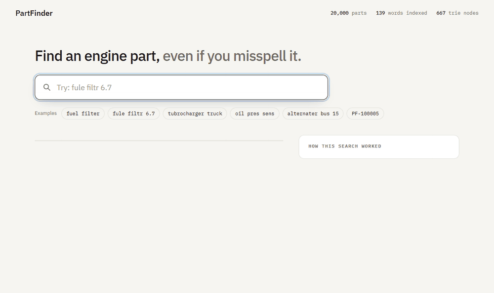
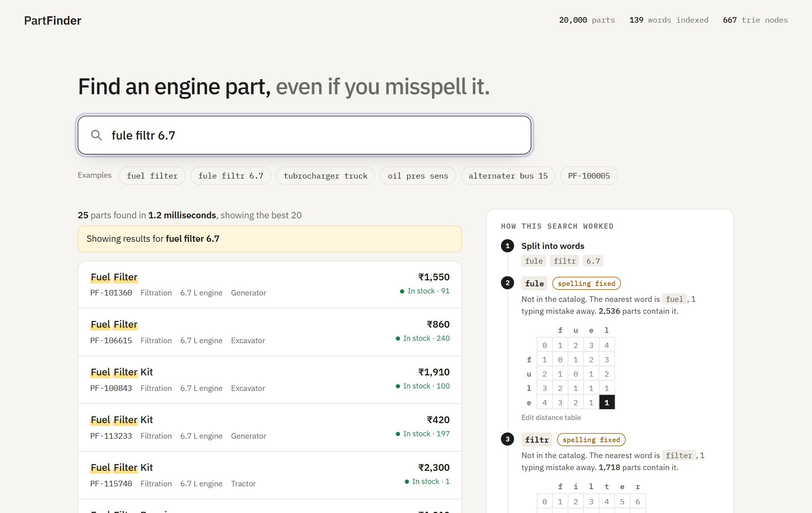

# PartFinder: a spare-parts search engine


PartFinder searches a catalog of 20,000 engine spare parts as you type. It completes half-typed words, fixes spelling mistakes, and usually answers in about a millisecond.

Type `fule filtr 6.7` and it finds the fuel filters for the 6.7 L engine.

The point of the project is that **every data structure is written from scratch**: a trie, a hash index, an edit-distance table, a heap and an LRU cache. No search library is used.



## What it does

- **Instant search** over 20,000 parts, by name, category, engine size and application.
- **Autocomplete** for the word being typed, most common word first.
- **Typo correction**: `tubrocharger` finds turbochargers, `alternater` finds alternators.
- **Part number lookup**: `PF-100005` goes straight to that part.
- **Ranking**: the best matches first, in-stock parts before out-of-stock ones.
- **"How this search worked" panel**: shows each step of the search, including the edit-distance table for a corrected word.
- **53 automated tests**, run again on GitHub after every push.



## The data structures

| Structure | File | Used for | Cost |
|---|---|---|---|
| **Inverted index** (hash map) | `search.py` | word → set of parts that contain it | O(1) per word |
| **Trie** | `trie.py` | autocomplete, and matching unfinished words | O(length of the prefix) to reach it |
| **Edit distance** (dynamic programming) | `edit_distance.py` | finding the word the user meant | O(m × n) for two words |
| **Min-heap** | `heap.py` | keeping the best 20 results | O(n log k) instead of sorting, O(n log n) |
| **LRU cache** (hash map + doubly linked list) | `lru_cache.py` | remembering recent searches | O(1) to read or write |
| **Hash map** | `search.py` | part number → part | O(1) |

## How one search works

Take the query `fule filtr 6.7`.

1. **Split into words**: `fule`, `filtr`, `6.7`.
2. **Match each word** against the catalog's vocabulary:
   - an exact match wins: `6.7` is in the index;
   - otherwise the word is either unfinished or misspelt. The **last** word is probably unfinished, so the trie is tried first for it. **Earlier** words are finished, so their spelling is checked first;
   - `fule` is one swap away from `fuel`, and `filtr` is one letter short of `filter`.
3. **Combine**: each word gives a set of parts. The intersection of the sets is the parts that contain every word. If the intersection is empty, parts containing any of the words are used instead.
4. **Rank**: a heap keeps the best 20, ordered by words matched, then words found in the part's name, then stock, then shorter names.
5. **Cache**: the answer is stored, so the same query next time skips all of the above.

## How fast is it?

`benchmark.py` compares the index with checking all 20,000 parts one by one.

```
Query                     Matches       Scan      Index   Faster
fuel filter                   183      974us       21us      47x
turbocharger                  374      917us        3us     310x
oil pressure sensor           207      916us       11us      81x
piston ring set 6.7            22      946us        7us     130x
gasket generator 15            26     1082us       10us     112x

On average the index is 93 times faster than the scan.
A complete search, with ranking, takes 501 microseconds on average.
```

These numbers are from one laptop and will differ on another. The scan is given its best case (the words of every part are split in advance).

## Run it

```bash
python -m venv .venv
.venv\Scripts\activate          # on macOS/Linux: source .venv/bin/activate
pip install -r requirements.txt

python app.py
```

Open http://127.0.0.1:5070

```bash
pytest                  # run the 53 tests
python benchmark.py     # index versus scan
python make_catalog.py  # rebuild data/parts.csv
```

## API

| Endpoint | Returns |
|---|---|
| `GET /api/search?q=fule+filtr&limit=20` | Results, the steps of the search, and the time taken |
| `GET /api/suggest?q=fuel+fi` | Completions for the word being typed |
| `GET /api/stats` | Catalog size, vocabulary size, trie nodes, cache hits and misses |

## Files

| File | What it does |
|---|---|
| `trie.py` | The trie |
| `heap.py` | The min-heap and `top_k` |
| `edit_distance.py` | The edit-distance table |
| `lru_cache.py` | The LRU cache |
| `search.py` | The search engine that uses the four above |
| `app.py` | Flask server: the page and the API |
| `benchmark.py` | Index versus scan timings |
| `make_catalog.py` | Generates the sample catalog |
| `tests/` | One test file per structure, plus the search engine |

## Limits

- **The catalog is made up.** `make_catalog.py` combines part names, variants, engine sizes and applications. The part numbers and prices are invented.
- **The vocabulary is small**: 139 different words. Spelling correction compares the typed word with every one of them, which is fine at this size. A catalog with hundreds of thousands of different words would need something smarter, such as a BK-tree.
- **Everything is in memory.** The catalog is loaded from a CSV file when the server starts. A real catalog would live in a database.
- **No understanding of meaning.** It does not know that "dynamo" and "alternator" are related. A plural such as "filters" does work, but only because it is one letter away from "filter".
- **A word that is both unfinished and misspelt** (`tubro`) is not matched.
